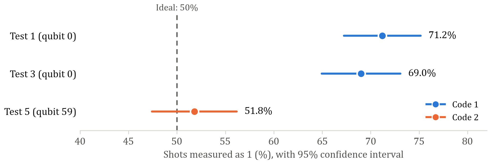

# Testing Quantum Circuits on IBM Hardware

Running simple quantum circuits on IBM's 156-qubit `ibm_kingston` processor, finding out why the results differ from theory, and building controls into the experiments to diagnose it. This is part of my 4th year university project, and it is ongoing.

## Key results

My first runs gave a 69–71% share of 1s where theory predicts 50%, even though the circuit was correct. Rewriting the experiment to select qubits from live calibration data and add control circuits gave a result consistent with 50%.



### Experiment A: single-qubit superposition

A Hadamard gate followed by a measurement, which should give 0 and 1 equally.

| Test | Code | Physical qubit | Read 0 | Read 1 | P(1), 95% CI | Distance from 50/50 |
|---|---|---|---|---|---|---|
| 1 | 1 | 0 | 144 | 356 | 0.712 ± 0.040 | 9.5σ |
| 3 | 1 | 0 | 155 | 345 | 0.690 ± 0.041 | 8.5σ |
| 5 | 2 | 59 | 241 | 259 | 0.518 ± 0.044 | 0.8σ |

In Test 5's control circuits, qubit 59 gave the wrong outcome in 0.2% of shots when prepared in |0⟩ and 0.4% when prepared in |1⟩.

### Experiment B: Bell state

A Hadamard and CNOT, which should give only `00` and `11`, with equal probability.

| Test | Code | Physical qubits | 00 | 01 | 10 | 11 | Correlated outcomes |
|---|---|---|---|---|---|---|---|
| 2 | 1 | 0, 1 | 95 | 89 | 55 | 261 | 71.2% |
| 4 | 1 | 0, 1 | 106 | 89 | 51 | 254 | 72.0% |
| 6 | 2 | 147, 148 | 241 | 5 | 40 | 214 | 91.0% |

Bitstrings read second qubit then first. All tests used 500 shots per circuit.

## What this does and doesn't show

- **The early bias was not shot noise or a circuit error.** It was far outside statistical expectation, and the transpiled circuit gives exactly 50/50 in a noiseless simulation.
- **IBM's calibration did not predict it.** Three minutes before Test 1, qubit 0 was listed with 0.85% readout error and 0.03% SX error.
- **The cause is not yet established.** Test 5 changed the qubit and the code, and also ran 15 days later, so these effects can't be separated.
- **Test 5 is a single run and may show drift.** Its counts of 1 per 100 shots were 59, 60, 48, 52 and 40 (χ² = 10.9, 4 d.o.f., p = 0.027). This may be chance, and needs repeat runs.
- **Test 6 is improved but not clean.** One control circuit was wrong 11.8% of the time, mostly because qubit 147 read 0 when prepared in |1⟩.

## How the experiments work

Code 2 improves on Code 1 in three main ways:

- **Qubit selection:** it picks qubits with the lowest combined error from live calibration data, rather than leaving the transpiler to use qubits 0 and 1.
- **Control circuits:** each job also measures prepare-all-0 and prepare-all-1 circuits on the same qubits, which gives a direct check on readout.
- **Provenance:** every run saves its raw shots, job ID, software versions and the calibration values used to select its qubits.

## Repository layout

| Path | Contents |
|---|---|
| `code/Test_run_hardware_1.py` | Code 1: the original experiment, used for Tests 1–4 |
| `code/Test_run_hardware_2.py` | Code 2: qubit selection and control circuits |
| `code/Calibration.py` | Reads the current readout errors for `ibm_kingston` |
| `code/hardware_runs/` | Raw shots and metadata for Tests 5 and 6 |
| `docs/` | Figures |

Raw shot files for Tests 1–4 aren't included yet. The counts above come from IBM's job records.

## Running it

Tested with Python 3.11.

```bash
pip install -r requirements.txt
```

To run a local noisy simulation, which needs no IBM account and uses no QPU time:

```bash
python code/Test_run_hardware_2.py --test
```

To run on real hardware, save your IBM Quantum credentials with `QiskitRuntimeService.save_account()`, then run the script without `--test`. This uses QPU time from your account.

## Next steps

- Repeat Code 2 on qubit 59 to check stability and test for drift.
- Run the same circuits and controls on qubits 0 and 59 in one session, to separate the qubit from the date.
- Investigate the control error on qubit 147 and improve how qubit pairs are selected.
